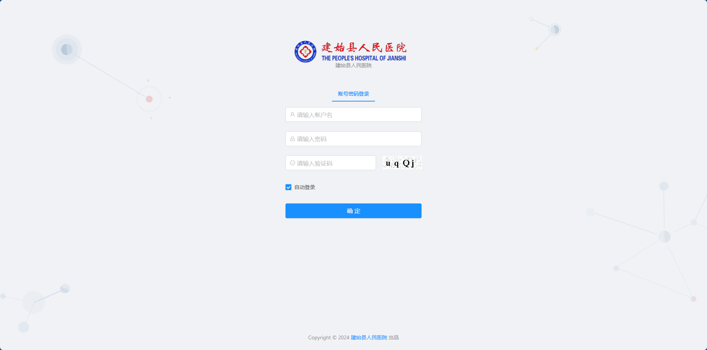
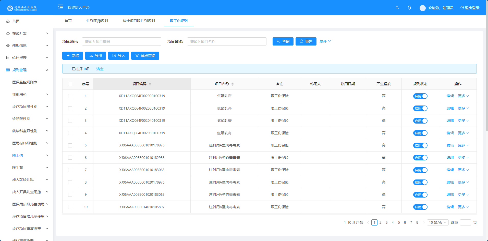
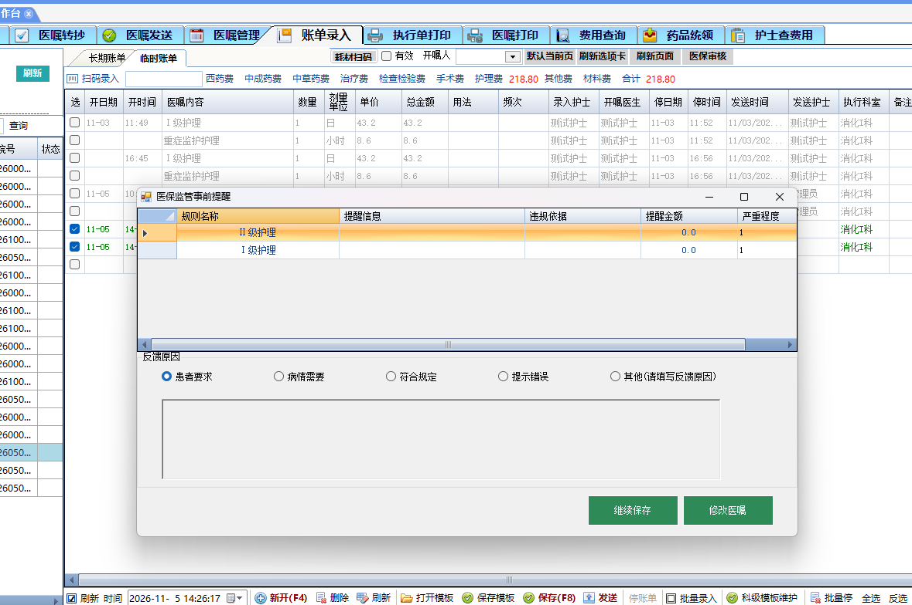
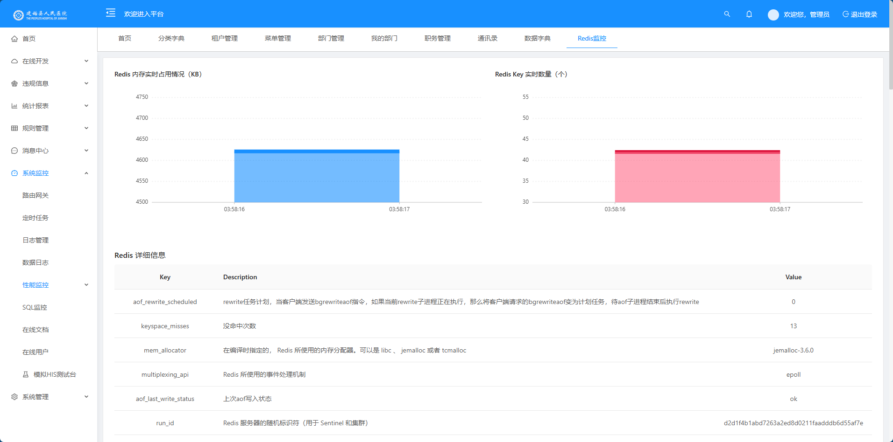

# 建始县人民医院 · 医保基金智能审核系统

> **本仓库为项目说明与界面预览。** 这是我在职交付的项目，出于合规考虑不公开业务源码、数据库结构与生产数据；
> 仓库只呈现系统架构、我负责的工作、技术选型与可公开的工程指标。

面向医院医保基金监管的**智能审核系统**：HIS 在医生开单、护士记账、预出院等保存动作中实时调用审核引擎，引擎按医保规则判定医嘱与费用明细，返回违规明细并在工作站弹窗提示；夜间再对在院与出院患者数据做批量抽取与缓存重建。

我接手时**原厂商已失联、无源码交接**，手上只有生产部署包（jar、DLL、Kettle 作业、数据库）。项目从系统接管、行为复现开始，逐步做到规则体系扩充、抽取实时化和高并发改造。

## 界面预览

> 截图取自测试与演示环境，不含患者姓名与完整就诊号。

<table>
  <tr>
    <td width="50%"><br><sub><b>登录界面</b>：医院统一门户风格，账号密码 + 验证码</sub></td>
    <td width="50%"><br><sub><b>规则配置</b>：按规则类别维护项目编码、严重程度与启停状态</sub></td>
  </tr>
  <tr>
    <td width="50%"><br><sub><b>事前提醒弹窗</b>：护士记账时命中「护理级别重复收费」，医生选择继续保存或修改医嘱</sub></td>
    <td width="50%"><br><sub><b>缓存监控</b>：引擎患者缓存与规则缓存的运行状态</sub></td>
  </tr>
</table>

## 系统架构

```text
┌──────────────── HIS 工作站 / 护士站 ────────────────┐
│  医生站 DLL（进程内挂载）        护士站账单录入        │
│        │ 保存动作触发                  │              │
│        ▼                               ▼              │
│  弹窗：违规明细 + 继续保存 / 返回修改                  │
└───────────────────────┬───────────────────────────────┘
                        │ HTTP  POST /rule（实时送审）
                        ▼
┌────────────────── 审核引擎（Java / Vert.x） ──────────────────┐
│  8888 实时审核 · 8088 结果页 · 规则缓存 · 患者缓存（Redis）    │
│  ├── 规则执行器：32 条实时规则，按场景 1/2/3 分派              │
│  ├── 当天费用直读 HIS 视图（T+0）+ 退费冲销                    │
│  └── 判定结果落库（Oracle）→ 平台违规记录 / 统计报表            │
└───────────────▲───────────────────────────┬──────────────────┘
                │ 缓存重建 / 规则刷新         │
┌───────────────┴──────────┐      ┌──────────▼─────────────────┐
│ Oracle 中间库（事实库）    │◀─────│ 数据抽取：Kettle 夜间链      │
│ 就诊/费用/结算/判定结果    │      │ 23:30 在院 · 23:40 出院      │
└──────────────────────────┘      │ → 逐步改为实时推送 + API     │
                                  └──────────▲─────────────────┘
                                             │
                                  ┌──────────┴─────────────────┐
                                  │ HIS 数据库（SQL Server）     │
                                  │ 就诊/诊断/手术/费用/结算视图  │
                                  └────────────────────────────┘
```

## 技术栈

| 层 | 选型 |
|---|---|
| 平台后端 | Java 8 · Spring Boot · MyBatis-Plus · Oracle 11g |
| 审核引擎 | Spring Boot 1.5 · Vert.x · Redis · 规则执行器 32 个 |
| 数据抽取 | Kettle（PDI 8.2）双定时链 · 后期改为实时推送 + API 抽取 |
| 数据库 | Oracle（事实库/规则库）· SQL Server（HIS）· Redis（缓存） |
| 部署 | Docker 四容器（Oracle / Redis / SQL Server / Nginx）· Nginx |
| 前端 | Jeecg Boot（Ant Design Vue）· 违规记录 / 统计报表 / 规则维护 |

## 我负责的工作

### 1. 无源码接管与行为复现

- 反编译审核引擎 jar、平台 265 个业务类与医生站 `Rule.dll`，还原 **32 条审核规则**、**14 个 HIS 视图契约**、**8 个引擎路由**与返回码语义；
- 以「字节级一致 + 行为级回放 + 数据级比对」三层交叉验证：引擎 jar 与生产 SHA256 一致，生产真实报文回放比对判定结果，39 列费用明细逐列、30 张规则表逐表核对；
- 用 Docker 四容器 1:1 复现全链路，建立 **62 项行为基线测试**（冒烟 / 数据层 / 页面 / Kettle 双链 / 引擎判定 / 弹窗端到端 / 写路径 / 非功能）。

### 2. 规则体系扩充

- 审核规则由 **27 条扩充到约 200 条**，把 32 个执行器按判定方式收敛为**六类算子**（集合、阈值/区间、配对、累计、时序、存在性），新规则只填参数、不写代码；
- 规则配置带启停与严重度，出问题可先停用再回滚。

### 3. 抽取实时化（T+1 → T+0）

- 原方案是 Kettle 夜间批量（23:30 / 23:40），数据次日才可用；
- 改为**实时推送 + API 抽取**双通道，高时效规则从“事后发现”变为“开单/记账即时拦截”；
- 幂等键 + 结果表“按就诊号先删后插”保证重复推送不重复计数。

### 4. 去 Kettle 改造

- 把 ETL 抽取链路重写为**纯 API 服务**，摆脱 Kettle / PDI 组件依赖；
- 补齐原由 Kettle 承担的职责：调度、失败重试、批次监控、告警。

### 5. 高并发与可靠性优化

从源码定位到 4 处瓶颈，逐项改造：

| 瓶颈（原版实现） | 改造方案 | 效果 |
|---|---|---|
| 患者缓存全量重建：先删键再逐批重建，重建期判定降级 | 新版本键写入完成后**原子切换指针**（类蓝绿） | 缓存空窗 30~60 秒 → 0 |
| 规则刷新：先删 Redis 键再异步重载，存在中间态 | **不可变规则集 + 原子引用替换** | 刷新期间零感知 |
| 引擎 8888 无鉴权、无参数校验，错误只返回 `code=2` | **前置网关**：令牌鉴权 + 令牌桶限流 + JSON Schema 校验，返回 `code/msg/field` 结构化错误 | 无效请求不进引擎，对接方可自助定位 |
| 每笔判定同步写 Oracle，RT 受存储拖累 | 判定结果**内存队列批量落库**（50 条 / 500ms），明细先入 Redis 保弹窗 | 接口 RT 与存储解耦 |

状态全部外置到 Redis 后，引擎本身无状态，前置负载均衡即可水平扩容。

## 关键指标

| 维度 | 数据 |
|---|---|
| 规则 | 实时规则 32 条 → 规则库约 200 条；配对规则表 402 条 |
| 视图契约 | HIS 视图 14 个，实际消费 7 个；对接规范覆盖 154 列 |
| 复现验证 | 62 项行为基线测试；39 列费用明细逐列一致；30 张规则表计数一致 |
| 时效 | 夜间批量 T+1 → 实时 T+0；缓存重建空窗 30~60s → 0 |
| 数据规模 | 三个 schema 备份约 9 G；审计日志 687 天（19 G，压缩 1.9 G） |

## 工程与交付

- **对接文档**：HIS 视图对接规范（逐列定义 + 验收 SQL）、分场景接口清单（8 个路由、弹窗按钮矩阵、返回码语义）、`code=2` 排查指南与自检脚本；
- **运维**：夜间双链巡检由人工 2 次/天改为定时自动巡检 48 次/天，异常告警；故障平均处理时长由 24 小时降到 0.5 小时；
- **迁移**：换服务器前完成三 schema 数据、配置、审计日志的全量备份与校验（md5 逐件比对），恢复步骤成文。

## 说明

- 本仓库**不含**源码、数据库结构、配置文件与生产数据；
- 截图来自测试/演示环境，已避免展示患者姓名与完整就诊号；
- 项目为医院真实生产系统，文中数据口径以交付时的测试与备份记录为准。
